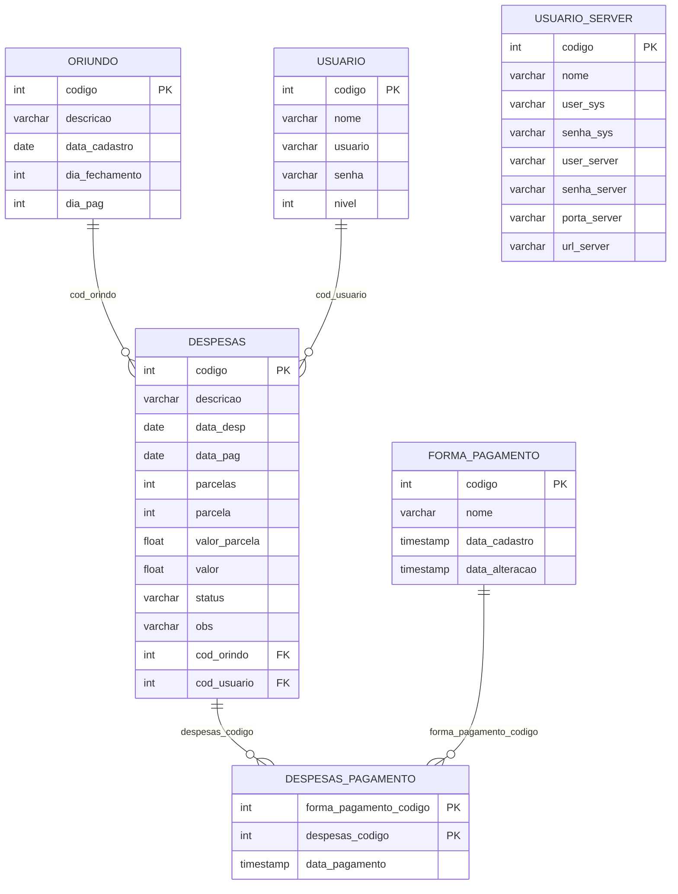

<p align="center">
  <picture>
    <source media="(prefers-color-scheme: dark)" srcset="docs/logo-dark.png">
    
  </picture>
</p>

<p align="center">
  Aplicativo desktop em Java Swing para controlar despesas pessoais, com parcelamento automático e data de pagamento calculada pelo fechamento do cartão.
</p>

<p align="center">
  <a href="https://github.com/Despesas/DesktopJava_Despesas/actions/workflows/ci.yml"></a>
  
  
  
  
  <a href="LICENSE"></a>
</p>

---

## Sobre

Projeto pessoal criado em 2015 para substituir a planilha de gastos do mês. Cada despesa é lançada uma vez, com o número de parcelas e a origem do pagamento (um cartão de crédito, por exemplo), e o sistema grava uma linha por parcela, já com a data em que cada uma vence. A tela principal mostra o que cai em cada mês e quanto falta pagar.

É um projeto NetBeans (Ant) com interface Swing feita no editor visual do NetBeans e acesso a dados em JDBC puro, organizado em DAOs e DTOs.

## Funcionalidades

- **Login** em uma base de contas (tabela `usuario_server`). Cada conta guarda também a conexão do banco de despesas daquele usuário, que o login grava para o restante do sistema usar.
- **Tela principal** com as despesas filtradas por mês, ano e origem de pagamento. Mostra código, descrição, origem, parcela ("2 de 10"), data de pagamento, data de lançamento, valor da parcela, valor total, valor restante e, no rodapé, a soma das parcelas do mês.
- **Cadastro de despesa** com descrição, status, observação, data, origem, parcela atual, total de parcelas e valores:
  - ao informar o valor total, calcula o valor da parcela e o restante; ao informar o valor da parcela, calcula o total;
  - ao escolher a origem, calcula a data de pagamento: compras antes do dia de fechamento vencem no mês seguinte, as demais dois meses depois;
  - despesas parceladas geram um registro por parcela restante, cada um um mês depois do anterior, com " P.:n" na descrição.
- **Cadastro rápido de origem de pagamento** (descrição, dia de fechamento, dia de pagamento) direto da tela de despesa, sem perder o que já foi digitado.
- **Alteração e exclusão** de despesa pelo código, com confirmação antes de excluir.
- **Formas de pagamento**: cadastro a partir da tela de pagamento, que também lista os anos com despesas e as origens.

## Modelo de dados

O esquema está em [`schema.sql`](schema.sql). Os modelos originais do MySQL Workbench ficam em [`docs/modelos/`](docs/modelos).



`USUARIO_SERVER` fica no banco de contas (que pode ser o mesmo banco). Os modelos do Workbench também têm tabelas de vale-refeição (`ticket_*`), que o código não usa.

## Configuração e banco de dados

### Requisitos

- JDK 8 (o projeto usa `com.sun.awt.AWTUtilities` na tela de abertura, uma API interna do JDK 8)
- MySQL 5.x. O driver incluído é o Connector/J 5.1.5; para MySQL 8, crie o usuário com `mysql_native_password` ou troque o driver em `lib/`.

### Criar o banco

```bash
mysql -u root -p < schema.sql
```

O script cria o banco `despesas`, as tabelas e um usuário de exemplo fictício (`usuario` / `senha`) em `usuario` e em `usuario_server`, apontando para `localhost:3306/despesas`.

### Arquivo de configuração

As credenciais ficam fora do código, em um `config.properties` que não é versionado:

```bash
cp config.example.properties config.properties
```

| Chave | Uso |
|---|---|
| `db.driver` | Driver JDBC (padrão `com.mysql.jdbc.Driver`) |
| `account.url`, `account.usuario`, `account.senha` | Banco de contas consultado no login |
| `db.url`, `db.usuario`, `db.senha` | Banco de despesas. Se `db.url` existir, é usado direto |
| `sessao.arquivo` | Sem `db.url`, o login grava aqui a conexão lida de `usuario_server` (padrão `~/.despesas/bancodedados.properties`) |

O arquivo é procurado nesta ordem: caminho em `-Ddespesas.config=...`, `config.properties` no diretório de execução e `~/.despesas/config.properties`.

## Como usar

1. Baixe o `Despesas.zip` da [página de releases](https://github.com/Despesas/DesktopJava_Despesas/releases) (ou compile, veja abaixo) e extraia.
2. Coloque o `config.properties` na mesma pasta e execute:
   ```bash
   java -jar Despesas.jar
   ```
3. Depois da tela de abertura, entre com o usuário e a senha cadastrados em `usuario_server`.
4. Na tela principal, use **Arquivo > Novo > Despesa** (ou o botão *Despesas* da barra de ferramentas) para lançar uma despesa e **Editar > Despesas** para alterar ou excluir pelo código. O botão *Pagamento* abre a tela de pagamento. Os filtros de mês, ano e origem e o botão de atualizar recarregam a tabela.

## Estrutura

```
build.xml, nbproject/         Projeto NetBeans (Ant); build.xml tem os alvos extras de teste e empacotamento
lib/                          AbsoluteLayout e MySQL Connector/J (lib/test/ é baixado pelo build)
src/com/projeto/despesa/
├── starter/                  Ponto de entrada (StartLogin), tela de abertura e inicialização das janelas
├── form/                     Telas Swing geradas pelo editor do NetBeans (.form + .java)
├── event/                    Comportamento das telas (listeners, cálculos, chamadas aos DAOs)
├── dao/                      Acesso ao MySQL com JDBC e PreparedStatement
├── dto/                      Objetos de dados (Despesas, Oriundo, Forma_pagamento, Usuario...)
├── utilitarios/              Conexão e configuração, datas, cálculo de parcelas, campos formatados, calendário
└── images/                   Ícones e imagens das telas
test/                         Testes JUnit 4
docs/modelos/                 Modelos do MySQL Workbench (.mwb)
schema.sql                    Esquema do banco
config.example.properties     Modelo de configuração, sem credenciais
```

## Compilar e testar

Os testes cobrem a lógica que não depende de banco nem de tela: cálculo de parcelas e valores, datas de pagamento, conversões de data, leitura da configuração, montagem das consultas, geração das parcelas e o mapeamento `ResultSet` → DTO (com um `ResultSet` simulado). Não é preciso MySQL para rodá-los.

**NetBeans:** abra a pasta como projeto (é um projeto Java SE com Ant) e use *Build*, *Test* e *Run*.

**Ant:**

```bash
ant clean jar test
```

O alvo `test` baixa o JUnit 4.13.2 e o Hamcrest 1.3 do Maven Central para `lib/test/` (conferindo o SHA-1) e roda os testes com o `JUnitCore`. O `jar` gera `dist/Despesas.jar` e copia as dependências para `dist/lib/`.

**Docker** (sem instalar JDK nem Ant):

```bash
docker run --rm -v "$PWD":/w -w /w eclipse-temurin:8-jdk bash -c '
  apt-get update -qq && apt-get install -y -qq ant >/dev/null &&
  ant -noinput clean jar test'
```

## CI/CD

O workflow [`ci.yml`](.github/workflows/ci.yml) roda no GitHub Actions a cada push e pull request em `master` e `develop`:

1. Instala o JDK 8 (Temurin) e o Ant em um runner Ubuntu.
2. Compila, gera o jar e roda os testes (`ant clean jar test`).
3. Empacota `Despesas.jar`, `lib/`, `config.example.properties`, `schema.sql`, `README.md` e `LICENSE` em `Despesas.zip` e guarda como artefato.
4. Em tags `v*`, publica uma release no GitHub com o zip anexado.

```bash
git tag v1.0.0
git push origin v1.0.0
```

## Limitações conhecidas

- As senhas ficam em texto puro nas tabelas `usuario` e `usuario_server`, e o login grava a senha do banco de despesas no arquivo de sessão. Serve para uso pessoal em máquina própria, não para vários usuários.
- A tela de pagamento só preenche os filtros e cadastra formas de pagamento; o botão **Pagar** não grava nada.
- Os itens de menu **Novo > Origem de Pagamento** e **Editar > Origem de Pagamento** não estão ligados a nenhuma ação; origens são cadastradas pela tela de despesa.
- Toda despesa é gravada com `cod_usuario = 1`.
- Valores monetários são `float` no banco e no código.
- A interface só roda em ambiente gráfico e foi pensada para Windows; os testes cobrem apenas a lógica.

## Melhorias de 2026

- Credenciais removidas do código e do histórico do Git; a configuração passou para `config.properties` (fora do controle de versão), com `config.example.properties` de modelo. O caminho fixo `c://Despesas/lib/bancodedados.properties` virou configurável.
- DAOs reescritos com try-with-resources: conexões, statements e result sets são sempre fechados (antes vazavam, e `finally` podia lançar `NullPointerException`).
- O filtro da tela principal montava o SQL concatenando os valores; agora usa parâmetros do `PreparedStatement`.
- Os métodos `localizar` de origens, formas de pagamento, usuários e pagamentos liam o `ResultSet` sem chamar `next()` e falhavam sempre; agora todos devolvem `null` quando o registro não existe.
- Login com usuário ou senha errados causava `NullPointerException`; agora mostra a mensagem de usuário não encontrado.
- Parcelas com vencimento em dia 29, 30 ou 31 pulavam um mês (31/01 virava 03/03); agora vão para o último dia do mês. Datas inexistentes, como 31/02, passaram a ser recusadas.
- A gravação parcelada roda em uma transação, e a falha ao gravar é mostrada ao usuário (antes havia `catch` vazio).
- Valores eram formatados com o idioma do sistema e relidos como pt-BR, o que quebrava fora de máquinas em português; a formatação agora é sempre pt-BR. A tela de alteração exibia o valor como `1234.5` e o regravava como 12345.
- Códigos de origem eram comparados com `==` entre `Integer` (errado acima de 127) e nomes de campos com `==` entre `String`; agora usam `equals`.
- `getIntAno` sobrescrevia a máscara de três dígitos, e o campo de data aceitava 11 caracteres.
- `despesas_pagamento` era gravada sem a forma de pagamento, que faz parte da chave primária.
- Classes duplicadas removidas: as entidades JPA (`dto/EntidadeBanco`) e Hibernate (`hibernate/`), que não eram usadas e exigiam bibliotecas que só existiam no NetBeans, além dos jars sem uso (Hibernate, Commons Logging, Glazed Lists). Os DTOs `Usuario` e `Usuario_server` voltaram ao pacote `com.projeto.despesa.dto`, e o `UsuarioDAO`, que não compilava, foi corrigido.
- A tela de login passou a ser aberta na thread de eventos do Swing.
- Projeto migrado de Java 6 para Java 8, com build fora do NetBeans (dependências em `dist/lib` e `Class-Path` no manifesto).
- Regras de cálculo extraídas para `CalculoParcela`, testes JUnit 4, `schema.sql`, pipeline de CI/CD e esta documentação.

## Licença

Distribuído sob a [licença MIT](LICENSE).
